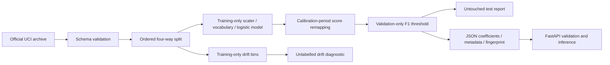

# Customer Response ML Service

[](https://github.com/dennis20413/customer-response-ml-service/actions/workflows/ci.yml)

A reproducible ML engineering lab: train on real historical campaign records, preserve time order, quantify failure under distribution shift, and serve the exact exported model through a validated API.

**Why this project:** a model notebook is only part of the work. This repository makes data leakage, calibration, baseline choice, serving consistency, schema validation, and model limitations inspectable. It complements a data science portfolio with concrete Python backend engineering.

> Research demo using old Portuguese marketing data. It is not a production marketing system or a lending decision tool. The observed negative score-remapping slope reverses the raw model's ranking; the evaluation explains this failure instead of hiding it.

## Quick start

Python 3.11 is the tested runtime. From the repository root:

```sh
python -m venv .venv
# macOS/Linux: source .venv/bin/activate
# PowerShell: .venv\Scripts\Activate.ps1
python -m pip install -r requirements-dev.txt
python -m pytest -q
python -m response_service.train --download
python -m uvicorn response_service.api:app --host 127.0.0.1 --port 8000
```

Open `http://127.0.0.1:8000/docs` for the interactive API. Training downloads the official UCI archive, preserves its row order, and writes local JSON artifacts. Tests use an attributed 412-row real-data fixture and do not download datasets.

```sh
curl -X POST http://127.0.0.1:8000/predict \
  -H "Content-Type: application/json" \
  --data-binary @examples/request.json
```

PowerShell request:

```powershell
Invoke-RestMethod -Uri http://127.0.0.1:8000/predict -Method Post `
  -ContentType application/json -InFile examples/request.json
```

Other endpoints: `GET /health` returns readiness (503 without a valid model); `GET /model` exposes the feature contract, frozen threshold, training partitions, and score-remapping behavior. `/predict` accepts 1-256 customers, rejects extra fields including `duration`, rejects nonfinite or out-of-range features, returns a model fingerprint, and counts unknown categorical values. Unknown categories use an all-zero one-hot vector; they are visible in the response for review.

## Evaluation protocol

The official `bank-additional-full.csv` has **41,188 date-ordered rows**. Four contiguous, nonoverlapping partitions serve different purposes:

| Partition | Zero-based positions [start, stop) | Purpose |
|---|---|---|
| Training | 0-20,594 | Fit preprocessing and logistic regression |
| Calibration | 20,594-26,772 | Fit logistic remapping of the frozen raw score |
| Validation | 26,772-32,950 | Select the demonstration F1 threshold |
| Final test | 32,950-41,188 | Report frozen-model performance |

`duration` is unavailable before a call ends. Current-call `campaign`, `contact`, `month`, and `day_of_week` are also excluded from the input contract. Numeric scaling and categorical vocabularies are fitted exclusively on training rows. The current model uses customer history and historical macroeconomic context; exact timestamps and customer IDs are unavailable.

The remapper is an unconstrained one-variable logistic regression. **A negative slope changes ranking**, so this implementation does not imply ordinary monotone calibration or guaranteed generalization. A calibration-period class-prior baseline is included alongside the older training prior to account for the calibrator's fresher labels. No model is selected using final-test metrics.

Measured on the 8,238 final-test rows:

| Frozen predictor | Log loss | Brier | ROC AUC |
|---|---:|---:|---:|
| Training-period class prior | 0.9774 | 0.2817 | 0.5000 |
| Calibration-period class prior | 0.9437 | 0.2785 | 0.5000 |
| Raw logistic regression | 1.7725 | 0.3058 | 0.3411 |
| Logistic score remapping | 0.6111 | 0.2111 | 0.6589 |

The fitted remapping slope is **-0.675742**, which reverses raw ranking. Positive-label prevalence rises from 4.68% in training to 30.83% in test. These results expose a temporal failure of the raw model and are not proof of a stable production model.

All partition/source details live in [reports/evaluation.md](reports/evaluation.md) and [reports/evaluation.json](reports/evaluation.json). The report includes raw and remapped scores, both prior baselines, reliability bins, and descriptive error slices. This is a temporal stress test; weak raw discrimination and shifted label prevalence are findings, not values to tune away on the same test set.

## Architecture



JSON inference is verified numerically against the fitted sklearn pipeline before writing the evaluation. No pickle file is loaded by the API. Feature transformations, coefficients, and score remapping are exported together; the API performs no training or outbound calls.

Inspect distribution shift after training:

```sh
python -m response_service.drift --csv data/bank-additional-full.csv --start-row 32950 --output reports/drift-diagnostic.json
```

PSI is computed against training-only quantile-midpoint bins with separate out-of-support bins. Constant training features use same-value versus changed-value bins. This unlabelled diagnostic cannot determine whether model quality or fairness has deteriorated; labelled evaluation is needed. It is not an automated retraining trigger.

## Engineering checks

- Chronological, disjoint splits; only training fits feature transformations.
- Changing final-test labels leaves coefficients, score remapping, and selected threshold unchanged.
- Serving predictions match the exported training pipeline to numerical precision.
- Invalid/unknown inputs, batch bounds, unavailable artifacts, and model parameter integrity.
- Shift diagnostics include zero-count and constant-feature cases.
- CI runs tests from the checked-in fixture without access to the raw dataset.

Container recipe (run training first; the trained artifact is intentionally untracked):

```sh
docker build -t customer-response-ml .
docker run --rm -p 127.0.0.1:8000:8000 customer-response-ml
```

The container runs as a non-root user. The recipe is supplied for reproducibility; see [validation notes](docs/validation.md) for which checks were actually executed. Authentication, TLS, operational monitoring, and production deployment are outside this local demo's scope.

## Portfolio and interview use

| Role | Evidence to discuss |
|---|---|
| Data science / ML intern | Temporal validation, leakage exclusions, prior baselines, probability losses, ranking reversal, honest limitations |
| AI application / software intern | Typed request contract, bounded batch API, safe JSON model export, startup readiness, deterministic tests, CI |
| Data engineering intern | Source checksum, validated ingestion, separated raw/artifact/report directories, training-only references |

**中文说明：**这个项目展示「从真实资料到可测试预测服务」的完整流程。面试重点不是夸大准确率，而是解释时间切分为何更严格、`duration` 为什么会泄漏结果、旧模型为何在新时期失效，以及如何保证训练与 API 推理一致。宏观变量跨时期变化很大，负的分数映射斜率是必须说明的问题；不能把这份结果宣称为台湾市场成效或实际营收提升。

See the [model card](docs/model-card.md) and [interview guide](docs/interview-guide.md). Claim only the functionality and measured results you have reproduced and can explain.

## Data and licensing

Moro, S., Rita, P., & Cortez, P. (2014). **Bank Marketing** [Dataset]. UCI Machine Learning Repository. [Dataset and DOI](https://doi.org/10.24432/C5K306). Dataset license: [CC BY 4.0](https://creativecommons.org/licenses/by/4.0/). The full raw dataset and trained artifacts are not committed. Source hashes are retained in [reports/data-provenance.json](reports/data-provenance.json); the test fixture documents its exact sampling method and attribution.

Project code is MIT licensed; the dataset and derived fixture retain their CC BY 4.0 attribution requirements.
